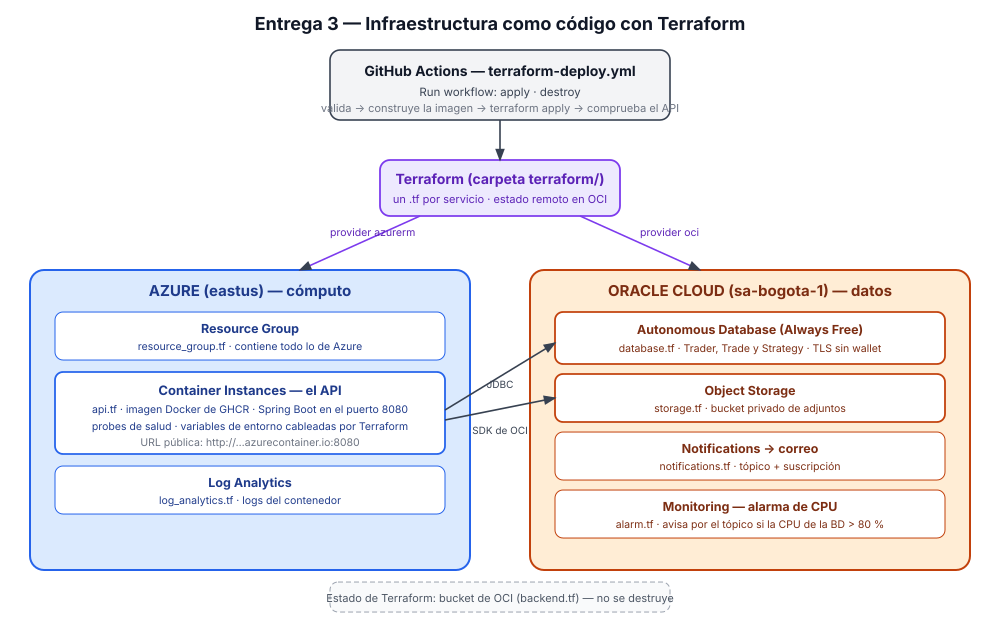
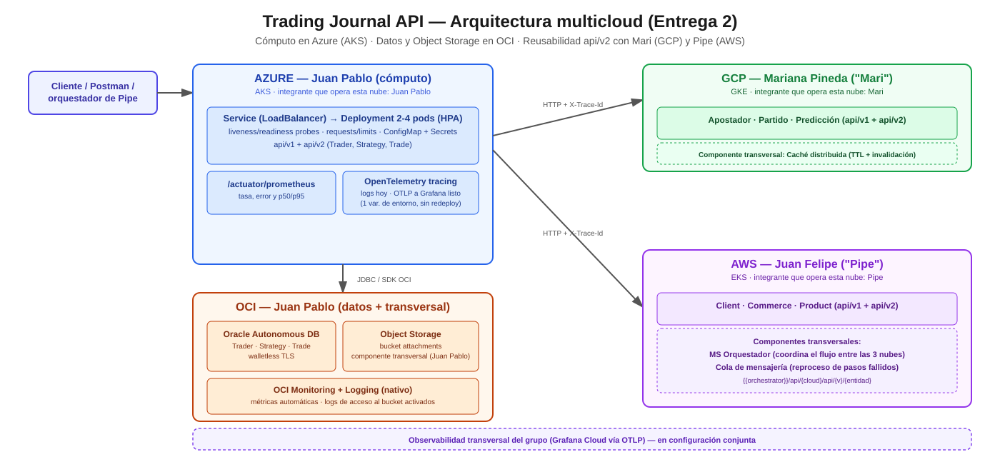

# Trading Journal API

Proyecto semestral de la materia de Desarrollo de Software. **Actividad 2 (Entrega 2, Énfasis DevOps)** — arquitectura multicloud, sobre la base de la Actividad 1 (API RESTful de registro y seguimiento de operaciones de trading).

> **Estado de la infraestructura (octubre de 2026):** tras la sustentación de la Entrega 2 se **eliminó toda la infraestructura en la nube** (clúster AKS en Azure; Autonomous Database, bucket de Object Storage y clúster OKE en OCI), por indicación del profesor. Las URL y las IP públicas que se mencionan más abajo pertenecen a esa entrega y **ya no existen**; el código, los manifiestos de `k8s/` y la colección de Postman se conservan como evidencia, y la versión entregada está en el tag [`v2.0.0`](https://github.com/JuanPa28/trading-journal-api/releases/tag/v2.0.0). La **Entrega 3 (Seguimiento #3, Terraform)** vuelve a crear la infraestructura mediante código, en la carpeta `terraform/`.

Grupo cerrado de 3 integrantes, cada uno con su propio repositorio y su propia nube de cómputo, reutilizando entidades entre las 3 API en tiempo real (sin datos quemados):

| Integrante | Repositorio | Nube de cómputo | Componente transversal propio |
|---|---|---|---|
| **Juan Pablo (este repo)** | `JuanPa28/trading-journal-api` | **Azure (AKS)** — cómputo movido de OCI por falta de capacidad gratuita, datos y storage se quedaron en OCI | **Object Storage** (OCI) |
| Mariana Pineda ("Mari") | `MarianaPineda0/StatsNostra` | GCP (GKE) | **Caché distribuida** |
| Juan Felipe ("Pipe") | `jfpa11100/ecommerce-api` | AWS | **MS Orquestador + cola de mensajería** |

## Entrega 3 — Infraestructura como código (Terraform)

La carpeta [`terraform/`](./terraform) crea, con un comando o con un pipeline, toda la infraestructura que el API necesita, y la elimina cuando ya no se usa. La arquitectura sigue la división de la Entrega 2: **datos en Oracle Cloud** y **cómputo en Azure**.



- **7 servicios en nube, uno por archivo `.tf`:** Autonomous Database, Object Storage, Notifications y Monitoring en OCI; Resource Group, Log Analytics y Container Instances (donde corre el API) en Azure.
- **Pipeline nuevo** ([`terraform-deploy.yml`](.github/workflows/terraform-deploy.yml)): *Actions → Terraform - Desplegar o destruir → Run workflow*. Con `apply` valida, compila y prueba, publica la imagen, crea la infraestructura, **instala el API** y comprueba que responde; con `destroy` elimina todo.
- **Eliminar la infraestructura al terminar la sustentación:** `destroy` en el pipeline, o `make destroy` / `bash scripts/destroy.sh` desde `terraform/`.
- **Evidencias de ejecución** (logs del pipeline, pruebas contra el API desplegado, inventario de ambas nubes): [`terraform/evidencias`](./terraform/evidencias).

Cómo desplegar desde cero, los secrets necesarios, costos y seguridad: [`terraform/README.md`](./terraform/README.md).

## Diagrama de arquitectura de la Entrega 2



**Qué integrante opera cada nube:** Juan Pablo — Azure (cómputo) + OCI (datos y Object Storage). Mariana Pineda ("Mari") — GCP. Juan Felipe ("Pipe") — AWS. (También resumido en la tabla de arriba.)

**Por qué el cómputo de Juan Pablo está en Azure y no en OCI (la nube originalmente asignada):** OCI se quedó sin capacidad gratuita de máquinas ARM para los nodos de Kubernetes (OKE) — más de 300 intentos automáticos fallidos durante varios días, un problema real de disponibilidad de Oracle, no un error de configuración. El profesor aprobó mover solo el cómputo del clúster a Azure (AKS), dejando la base de datos (Oracle Autonomous DB) y el Object Storage exactamente donde ya estaban funcionando y probados en OCI. El clúster de OKE en OCI se dejó creado (control plane activo, sin nodos) por si Oracle liberaba capacidad, y el pipeline lo intentaba en cada despliegue sin bloquear nada; nunca llegó a haber capacidad y se eliminó junto con el resto de la infraestructura.

## Servicios adicionales (justificación)

El `Service` de Kubernetes tipo `LoadBalancer` (`k8s/service.yaml`) es un **balanceador de carga real**, no solo un enrutador: reparte el tráfico entrante entre las 2-4 réplicas del pod (según el HPA), con una única IP pública estable aunque el número de pods cambie. Cumple el punto de la rúbrica sobre agregar servicios adicionales no mencionados explícitamente en la arquitectura base — en este caso no se agregó un componente nuevo aparte, sino que se reconoce y justifica uno que ya forma parte necesaria del despliegue en Kubernetes.

## Entidades propias

- **Trader**: usuario que registra sus operaciones (nombre, usuario, correo, fondos disponibles). Sin autenticación en esta entrega.
- **Strategy**: checklist de 7 confluencias de trading (HTF PD Array, IFVG, CISD, seguí mis reglas, continuación, reversal, riesgo correcto). Cada Trade crea su propia Strategy — nunca se reutiliza una existente.
- **Trade**: operación individual (contrato, tamaño, dirección, entrada/salida, P&L), asociada a un Trader y a su propia Strategy (relación obligatoria).

## API

- **`/api/...`** — CRUD original de la Actividad 1 (13 endpoints), incluye el verbo HTTP `QUERY` literal para búsqueda (`QUERY /api/trades/query`).
- **`/api/v2/...`** — capa nueva de la Entrega 2:
  - CRUD completo espejado para `Trader`, `Strategy` y `Trade` (`TraderV2Controller`, `StrategyV2Controller`, `TradeV2Controller`); el `GetById` de cada una viene enriquecido con **una entidad de Mari** (`Partido` o `Predicción`, elegida al azar de su lista completa — "GET RANDOM") y **una de Pipe** (`Commerce` o `Product`, mismo patrón), obtenidas **en tiempo real por HTTP**, nunca copiadas ni quemadas.
  - `POST`/`GET /api/v2/attachments` — el componente de Object Storage.
  - Cada petición entrante genera o recibe un `X-Trace-Id`, que queda en los logs (MDC) y se reenvía a Mari y a Pipe cuando este repo los llama — permite seguir una misma petición a través de las 3 nubes.
  - Cada entidad se puede llamar y modificar individualmente en tiempo real (`PUT`/`PATCH` en `/api/v1/...`) — un cambio hecho así (o directo en la base de datos) se refleja de inmediato en la próxima respuesta de `api/v2`, porque nunca se cachea ni se copia el dato, siempre se consulta en el momento.

Colección de Postman completa en [`postman/`](./postman).

## Stack

- Java 21 (Temurin) + Spring Boot 4.1.0
- Maven
- **Oracle Autonomous Database** (producción, walletless TLS) / PostgreSQL 17 (local, Docker)
- **Kubernetes** (AKS) — Deployment (2-4 réplicas vía HPA), Service LoadBalancer, ConfigMap, 3 Secrets, liveness/readiness probes, requests/limits de recursos
- **OCI Object Storage** — SDK oficial de Java
- **Observabilidad**: Micrometer + Prometheus (`/actuator/prometheus`, histograma de latencia p50/p95 por endpoint) + OpenTelemetry (trazas y métricas exportadas por OTLP a Grafana Cloud, la herramienta SAAS transversal del grupo) + monitoreo nativo de OCI (métricas + logs del bucket)
- Docker / Docker Compose (build multi-stage)
- JUnit 5 + Mockito + JaCoCo — 68 pruebas (el reporte de cobertura se genera, sin gate mínimo obligatorio)
- GitHub Actions (CI/CD) — build → test → build & push de imagen → despliegue automático a Kubernetes

## Cómo correr el proyecto

### Local (Docker, contra Postgres — para desarrollo)

```bash
docker compose -f docker-compose.yml up --build -d       # Ambiente Pruebas, puerto 8080
docker compose -f docker-compose.prod.yml up --build -d  # Ambiente Producción, puerto 8081
```

### Producción real de la Entrega 2 (Azure AKS + Oracle + OCI) — ya eliminada

Estos comandos describen cómo se accedía al clúster durante la Entrega 2; el clúster ya no existe (ver la nota de estado al inicio).

```bash
az login
az aks get-credentials --resource-group trading-journal-rg-eastus --name trading-journal-aks
kubectl get svc trading-journal-api   # columna EXTERNAL-IP es la URL pública actual
```

Ver [`k8s/README.md`](./k8s/README.md) para la lista completa de Secrets y el paso a paso de despliegue manual.

## Pruebas

```bash
mvn clean verify
```

Corre las 68 pruebas y genera el reporte de cobertura de JaCoCo (`target/site/jacoco`). Si alguna prueba falla, el build se detiene con `BUILD FAILURE` antes de publicar cualquier imagen — no hay un porcentaje mínimo de cobertura exigido en esta entrega.

## CI/CD

**No es un requisito de esta entrega** (la rúbrica de Entrega 2 no lo pide explícitamente), pero se mantuvo porque sigue siendo la forma más confiable de desplegar sin pasos manuales — y porque el componente transversal (Object Storage) sí debe "versionarse... con su propio contenedor, su pipeline de despliegue y su documentación de uso" según la rúbrica, y al vivir dentro de esta misma API, hereda el mismo pipeline.

Durante la Entrega 2 hubo dos workflows (`prod-pipeline.yml` y `test-pipeline.yml`): construían, probaban y publicaban la imagen, y desplegaban a AKS en cada push a `main`. **Se retiraron** al eliminarse los clústeres, porque habrían fallado en cada commit; siguen disponibles en el tag `v2.0.0`.

Hoy hay un workflow en GitHub Actions ([`.github/workflows/`](./.github/workflows)):

- **`ci.yml`**, en cada push a `main` y en cada pull request: compila y corre las pruebas, sin desplegar nada.

El despliegue de la infraestructura y del API de la Entrega 3 lo hace el pipeline [`terraform-deploy.yml`](.github/workflows/terraform-deploy.yml) (manual, con las acciones `apply` y `destroy`); ver la sección de la Entrega 3 más arriba.

## Convención de commits

GitMoji ([gitmoji.dev](https://gitmoji.dev/)) en cada commit — muchos commits pequeños, cada uno enfocado en un solo cambio. Versionado semántico con tags de Git (`v1.0.0` al cierre de la Actividad 1, `v2.0.0` al de la Entrega 2 y `v3.0.0` al de la Entrega 3).
