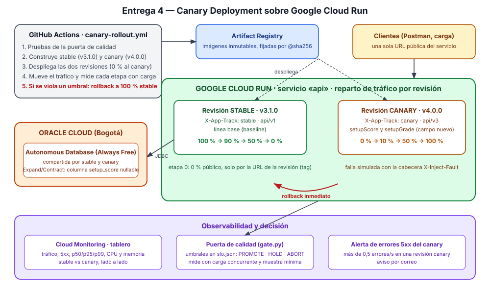

# Entrega 4 — Canary Deployment en Google Cloud Run

Estrategia completa de **Canary Deployment** para el Trading Journal API: una versión nueva (`canary`, **v4.0.0**) convive en producción con la estable (`stable`, **v3.1.0**), recibe el tráfico por etapas con porcentajes explícitos, se mide contra la línea base bajo la misma carga y se promueve o se revierte de forma automática según umbrales definidos antes de desplegar.



| | |
|---|---|
| **Plataforma** | Google Cloud Run (cómputo) · Oracle Autonomous Database Always Free (datos) · GitHub Actions (CI/CD) |
| **Mecanismo de enrutamiento** | *Traffic splitting* de Cloud Run entre dos revisiones del mismo servicio, identificadas con las etiquetas (`tags`) `stable` y `canary` |
| **Artefactos inmutables** | Imágenes en Artifact Registry referenciadas por **digest `@sha256`**, nunca por una etiqueta movible |
| **Versiones** | stable `v3.1.0` (rutas `api/v1`) · canary `v4.0.0` (rutas `api/v3` y campos nuevos) |
| **Costo** | $0: todo cabe en las capas gratuitas (ver [Costos y seguridad](#costos-y-seguridad)) |

## Contenido

1. [Qué cambia en la versión canary](#qué-cambia-en-la-versión-canary)
2. [Identificar qué versión atendió cada petición](#identificar-qué-versión-atendió-cada-petición)
3. [Plan de etapas](#plan-de-etapas)
4. [Compatibilidad de datos: Expand/Contract](#compatibilidad-de-datos-expandcontract)
5. [Observabilidad, SLI y SLO](#observabilidad-sli-y-slo)
6. [Inyección de fallos y rollback](#inyección-de-fallos-y-rollback)
7. [Cómo ejecutarlo](#cómo-ejecutarlo)
8. [Estructura de esta carpeta](#estructura-de-esta-carpeta)
9. [Costos y seguridad](#costos-y-seguridad)
10. [Cumplimiento del enunciado](#cumplimiento-del-enunciado)

## Qué cambia en la versión canary

| | stable `v3.1.0` | canary `v4.0.0` |
|---|---|---|
| Rutas de trades | `/api/trades` (= `/api/v1/trades`) | las mismas, y además `/api/v3/trades` |
| Respuesta de un trade | campos de siempre | + **`setupScore`** (0 a 7 confluencias cumplidas) y **`setupGrade`** (A: 6-7, B: 4-5, C: 0-3) |
| Base de datos | tabla `trades` | misma tabla, con la columna nueva **`setup_score`**, nullable |
| Inyección de fallos | nunca | solo el canary obedece la cabecera `X-Inject-Fault` |

El cambio funcional es **observable** sobre las entidades del proyecto: el mismo `GET /api/trades/{id}` devuelve el puntaje y la calificación del setup cuando lo atiende el canary, y no los devuelve cuando lo atiende la estable. La ruta `/api/v3/trades` permite probar la versión nueva de forma explícita en la etapa de 0 % de tráfico.

## Identificar qué versión atendió cada petición

**Toda** respuesta (también los errores y `/actuator`) trae dos cabeceras HTTP:

```text
X-App-Version: 4.0.0
X-App-Track: canary
```

La versión y el track salen de las variables de entorno `APP_VERSION` y `APP_TRACK` de cada revisión; la misma imagen se podría promover sin reconstruirla. Con esto, en vivo, se ve qué instancia procesa cada solicitud:

```bash
for i in 1 2 3 4 5 6 7 8 9 10; do curl -s -D - -o /dev/null "$URL/actuator/health" | grep -i x-app-track; done
```

## Plan de etapas

El tráfico avanza por etapas con porcentajes explícitos. Cada etapa se mide con carga concurrente y solo se promueve si la puerta de calidad lo aprueba. Los tiempos reales viven en [`slo.json`](slo.json); al ejecutar el pipeline se puede acortar el tiempo de medición (`bake_seconds`) para una demostración.

| Etapa | Tráfico al canary | Tiempo de horneado (bake) real | Mínimo de peticiones al canary | Cómo se accede |
|---|---|---|---|---|
| **0** | **0 %** (acceso interno) | prueba de humo | 30, con 0 errores | Solo por la URL de la revisión (`https://canary---<servicio>…run.app`), sin tráfico público |
| **1** | **10 %** | 15 min | 60 | URL pública del servicio |
| **2** | **50 %** | 30 min | 150 | URL pública del servicio |
| **3** | **100 %** (promovido) | 60 min | 150 | URL pública del servicio |

- **Etapa 0.** El canary se despliega con `--no-traffic` y una etiqueta propia. Cloud Run le da una URL exclusiva de esa revisión: así se hace la prueba de humo sin exponerlo al público.
- **Reparto.** Cloud Run reparte **por petición** según los porcentajes. No se usan sesiones fijas (*sticky sessions*): Cloud Run las ofrece como afinidad de sesión, pero aquí se evita a propósito porque haría que el reparto observado se desvíe del porcentaje y que una misma persona quedara atada a una versión defectuosa.
- **Tamaño de muestra.** No se decide con pocas peticiones: si el canary no alcanza el mínimo de la etapa, la decisión es **HOLD** y se alarga la medición (hasta 3 rondas extra). Si aun así no hay evidencia suficiente, **no se promueve y se revierte**.
- **Automatización.** Las etapas las ejecuta [`rollout.py`](rollout.py) desde el pipeline [`canary-rollout.yml`](../.github/workflows/canary-rollout.yml); nada se mueve a mano.

## Compatibilidad de datos: Expand/Contract

La estable y el canary **comparten la misma base de datos** a la vez, y el rollback tiene que ser siempre posible. Por eso el cambio de esquema sigue el patrón *Expand/Contract*, en tres fases:

| Fase | Qué se hace | En esta entrega |
|---|---|---|
| **Expand** | Se **agrega** algo nuevo y compatible: una columna *nullable*. Nada se renombra ni se borra. | `trades.setup_score INTEGER NULL`, creada por el canary |
| **Migrate** | Se pasa a usar lo nuevo. La versión nueva escribe el dato; la anterior lo ignora. | El canary guarda `setup_score` al crear o actualizar; las filas de la estable quedan en `NULL` y el canary las **calcula al leer**, sin escribir nada |
| **Contract** | Solo cuando la versión vieja ya no existe, se limpia lo obsoleto. | No se hace en esta entrega: nunca se hacen cambios destructivos mientras pueda haber rollback |

Por qué el rollback es seguro:

- La estable **no conoce** `setup_score`: sus `INSERT` no lo incluyen y la columna acepta `NULL`, así que sigue funcionando intacta.
- No hay migraciones destructivas (no se borran ni se cambian de tipo columnas), por lo que volver a la estable nunca deja datos ilegibles.
- Lo que el canary escribió (la columna rellena) simplemente queda ahí sin molestar.

Este servicio no usa colas ni caché propias, así que la compatibilidad se concentra en la base de datos relacional.

## Observabilidad, SLI y SLO

### Señales (SLI) separadas por versión

| Señal dorada | Cómo se mide | Dónde se ve |
|---|---|---|
| **Tráfico** | peticiones por segundo por revisión | tablero de Cloud Monitoring · carga del pipeline |
| **Errores** | tasa de 5xx por revisión (y fallos sin respuesta) | tablero · carga del pipeline |
| **Latencia** | p50, p95 y p99 por revisión | tablero · carga del pipeline |
| **Saturación** | CPU y memoria (p99 de utilización) por revisión | tablero · puerta de calidad |
| **Negocio** | **trades creados por segundo** (`trades.created`, métrica basada en logs `trades_created`) | tablero |

Hay dos fuentes que se complementan:

1. **Plataforma:** Cloud Run publica sus métricas con la etiqueta `revision_name`, así que cada línea del tablero es una versión.
2. **Aplicación:** Micrometer etiqueta toda métrica con `version` y `track` (`management.metrics.tags`), y la API cuenta los trades creados.

### Tablero lado a lado

[`monitoring/dashboard.json`](monitoring/dashboard.json) crea el tablero **«Canary: stable vs canary»** en Cloud Monitoring con tráfico, errores 5xx, latencias p50/p95/p99, CPU, memoria, instancias y la métrica de negocio, una línea por revisión. Se instala con [`monitoring/setup-monitoring.sh`](monitoring/setup-monitoring.sh).

### Umbrales de decisión (SLO) versionados como código

Los define [`slo.json`](slo.json) **antes** de desplegar, y los aplica [`gate.py`](gate.py):

| Resultado | Condición |
|---|---|
| **ABORT** (rollback inmediato) | tasa de errores del canary **> 2 %**, **o** más de **1 punto porcentual** por encima de la estable, **o** latencia p95 > `max(1,30 × p95 estable, p95 estable + 150 ms)` |
| **HOLD** (pausar y volver a medir) | muestra insuficiente (menos peticiones que el mínimo de la etapa), p99 > `max(1,5 × p99 estable, p99 estable + 300 ms)`, CPU o memoria del canary **> 90 %** |
| **PROMOTE** (pasar a la siguiente etapa) | todos los umbrales se cumplen con muestra suficiente |

Es una comparación **justa**: las dos versiones reciben la **misma mezcla de peticiones** a la vez (lecturas por id y creaciones de trades, desde 12 hilos concurrentes), y solo se compara con muestra suficiente. En la etapa del 100 % ya no queda tráfico estable, así que se compara contra la línea base medida en la etapa anterior.

## Inyección de fallos y rollback

Para simular una regresión en producción **sin tocar el código de la versión estable**, el canary acepta la cabecera `X-Inject-Fault: error` (activada con `FAULT_HEADER_ENABLED=true`) y responde `500` a esas peticiones. También admite `FAULT_ERROR_RATE` y `FAULT_LATENCY_MS` por variable de entorno. **La versión estable nunca falla**, aunque reciba la cabecera.

En el pipeline se usa con `fault_rate` y `fault_from_stage`: a partir de la etapa elegida, esa fracción de las peticiones lleva la cabecera. Solo el canary la obedece, así que se ve como una regresión que aparece cuando ya recibe tráfico real.

Cuando la puerta de calidad decide **ABORT**:

1. `rollout.py` fija **0 % al canary y 100 % a stable** (`--to-tags stable=100`), de inmediato.
2. Los datos no se tocan: la columna nueva es compatible y la estable sigue leyendo todo.
3. Se guarda un informe JSON con las mediciones y el motivo.

Además, la **alerta** de Cloud Monitoring [`monitoring/alert-policy.json`](monitoring/alert-policy.json) avisa por correo si una revisión canary supera 0,5 errores 5xx por segundo, por si la puerta de calidad no estuviera corriendo.

## Cómo ejecutarlo

### Desde GitHub Actions (el camino normal)

**Actions → Canary - Desplegar y promover → Run workflow**

| Entrada | Qué hace |
|---|---|
| `action` | `rollout` construye, despliega y promueve; `teardown` elimina el servicio y las imágenes |
| `stable_ref` / `canary_ref` | tags de las dos versiones (`v3.1.0` y `v4.0.0`) |
| `bake_seconds` | segundos de medición por etapa (`0` usa los tiempos reales de `slo.json`; para demostrar, 45-60) |
| `fault_rate` | fracción de peticiones con regresión simulada (`0` = promoción exitosa; `0.4` = rollback) |
| `fault_from_stage` | etapa en la que empieza la regresión |

Escenarios de la sustentación:

- **Promoción exitosa hasta el 100 %:** `fault_rate = 0`.
- **Rollback inmediato:** `fault_rate = 0.4`, `fault_from_stage = etapa-2`.

### Desde la terminal

```bash
# Despliegue completo con imágenes ya publicadas (por digest)
python canary/rollout.py run \
  --stable-image  us-central1-docker.pkg.dev/<proyecto>/trading-journal/api@sha256:<digest> --stable-version 3.1.0 \
  --canary-image  us-central1-docker.pkg.dev/<proyecto>/trading-journal/api@sha256:<digest> --canary-version 4.0.0 \
  --bake-seconds 45 --report canary/reports/informe.json

# Con regresión simulada desde la etapa 2
python canary/rollout.py run ... --fault-rate 0.4 --fault-from-stage etapa-2

# Pasos sueltos
python canary/rollout.py traffic --canary-percent 25     # repartir a mano
python canary/rollout.py rollback                         # 100 % a stable
python canary/rollout.py --dry-run run ...                # solo muestra los comandos de gcloud
```

### Preparación de una sola vez

```bash
cd canary/db && terraform init && terraform apply     # base Oracle Always Free
bash canary/scripts/setup-gcp.sh                      # cuenta de servicio y secretos
ALERT_EMAIL=<correo> bash canary/monitoring/setup-monitoring.sh   # tablero, métrica y alerta
```

### Eliminar todo al terminar

```bash
bash canary/scripts/teardown.sh        # servicio de Cloud Run e imágenes
cd canary/db && terraform destroy      # base de datos
```

También se puede hacer desde el pipeline con `action = teardown`.

## Estructura de esta carpeta

```text
canary/
├── README.md              # este documento
├── slo.json               # etapas, tiempos de horneado y umbrales de decisión (SLO)
├── gate.py                # puerta de calidad: PROMOTE / HOLD / ABORT (funciones puras)
├── load.py                # carga concurrente que registra el track de cada respuesta
├── rollout.py             # orquestador: despliegue, reparto de tráfico por etapas y rollback
├── tests/                 # pruebas unitarias de la puerta de calidad y del orquestador
├── monitoring/            # tablero, alerta y script de instalación (Cloud Monitoring)
├── db/                    # Terraform de la base de datos Oracle Always Free compartida
├── scripts/               # preparación de Google Cloud y eliminación
└── evidencias/            # informes y registros de las ejecuciones reales
```

## Costos y seguridad

**Costo $0 si se respeta el diseño:**

- **Cloud Run** con `min-instances 0`: sin tráfico no hay instancias ni cobro. La capa gratuita mensual cubre 2 millones de peticiones y 180 000 segundos de vCPU; una demostración completa usa una fracción mínima.
- **Artifact Registry:** las dos imágenes comparten capas base y caben en los 0,5 GB gratuitos.
- **Secret Manager, Cloud Monitoring y Cloud Logging:** dentro de sus cuotas gratuitas.
- **Oracle Autonomous Database:** Always Free.
- **GitHub Actions:** ejecución manual (no corre en cada push).
- Hay un **presupuesto de alerta de 5 USD** en la cuenta de facturación, con avisos al 50 %, 90 % y 100 %.

**Seguridad:**

- GitHub Actions entra a Google Cloud por **Workload Identity Federation**, restringida a este repositorio: no hay llaves guardadas.
- La contraseña de la base, la URL de conexión y la llave de Oracle viven en **Secret Manager**, nunca en el código ni en variables en claro. El API corre con una cuenta de servicio propia que solo puede leer esos secretos.
- La base acepta conexiones de cualquier IP (`0.0.0.0/0`) porque Cloud Run no tiene una IP de salida fija; la protegen TLS y contraseña. Es una simplificación de laboratorio; en producción se usaría un endpoint privado.

## Cumplimiento del enunciado

| Requisito | Dónde se cumple |
|---|---|
| Canary en nube pública, con el API del semestre | Cloud Run + este repositorio |
| Versión nueva que conviva con la estable | revisiones `stable` (v3.1.0) y `canary` (v4.0.0) del mismo servicio |
| Versión y track en todas las respuestas | cabeceras `X-App-Version` y `X-App-Track` |
| Cambio funcional observable y Expand/Contract | `setupScore` / `setupGrade` y la columna nullable `setup_score` |
| División de tráfico por etapas con bake time | [Plan de etapas](#plan-de-etapas) y `slo.json` |
| Artefacto inmutable y etapas automatizadas | imágenes por digest y `canary-rollout.yml` |
| Métricas por versión (tráfico, errores, latencia, saturación, negocio) | [Observabilidad](#observabilidad-sli-y-slo) |
| Comparación justa con muestra representativa | carga concurrente idéntica y mínimo de peticiones por etapa |
| Umbrales versionados como código | `slo.json` y `gate.py` |
| Inyección de fallos en el canary | cabecera `X-Inject-Fault`, solo en canary |
| Quality gate con aborto y rollback | `gate.py` + `rollout.py rollback` + alerta de Cloud Monitoring |
| Tablero stable vs canary | `monitoring/dashboard.json` |
| GitMoji, SemVer y release desde un tag | commits con GitMoji; tags `v3.1.0` y `v4.0.0` |
