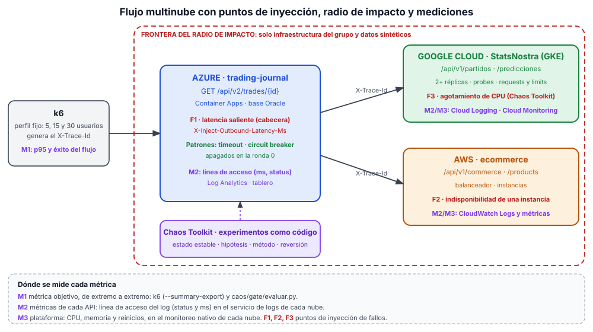

# Ingeniería del Caos — flujo multinube de las tres APIs

Seguimiento #4 (DevOps). Un flujo síncrono de punta a punta, con un generador de carga fijo y experimentos de caos declarados como código, para refutar una hipótesis de resiliencia, mejorar el sistema y demostrar la mejora con datos comparables.

> Estado del flujo (13 de noviembre): las tres APIs responden y el coordinador recorre las tres nubes; ver [`resultados/01-flujo-por-las-tres-nubes.md`](resultados/01-flujo-por-las-tres-nubes.md).

> Estado: rondas 0 y 1 del coordinador ejecutadas el 16 de noviembre de 2026; informe en [`informe/informe-caos-final.pdf`](informe/informe-caos-final.pdf). Entrega el 18 de noviembre (tag v5.0.0). Pendiente: la evidencia de Pipe.

## El flujo

```text
Cliente (k6, perfil fijo)
   │  X-Trace-Id
   ▼
Coordinador (Juan) ── Azure Container Apps ──► base de datos Oracle
   GET /api/v2/trades/{id}
   │  X-Trace-Id               │  X-Trace-Id
   ▼                           ▼
Mari · Google Cloud (GKE)      Pipe · AWS
/api/v1/partidos               /api/v1/commerce
/api/v1/predicciones           /api/v1/products
```

El coordinador llama en cadena a una entidad de cada compañero y reenvía el identificador de correlación. Cada API está en una nube distinta.



**F1, F2 y F3** son los tres puntos de inyección (uno por integrante); la línea roja es la frontera del radio de impacto; **M1, M2 y M3** son los tres niveles de medición (extremo a extremo, cada API, plataforma).

### Qué se conserva y qué se retira del flujo anterior

| Se conserva | Se retira |
|---|---|
| Las tres APIs completas, cada una en su nube; el flujo síncrono con el trace id de extremo a extremo; la observabilidad | La cola de mensajería, la caché distribuida y el almacenamiento de objetos como piezas obligatorias del flujo |

## Matriz integrante – fallo – métrica – patrón

| Integrante | Fallo | Métrica objetivo | Patrones de resiliencia |
|---|---|---|---|
| Juan (Azure) | (a) latencia inyectada en la llamada saliente hacia Mari | latencia p95 extremo a extremo | timeout por llamada y circuit breaker con degradación (aplicados); paralelismo en el backlog |
| Pipe (AWS) | (b) indisponibilidad de su API (detener el 50 % de las tareas ECS) | éxito del flujo y MTTR | pendiente de su evidencia |
| Mari (GKE) | (c) agotamiento de CPU de un pod | latencia p95 extremo a extremo | readiness por saturación, más CPU y HPA (en su repositorio: p95 de 3 425 ms a 774 ms) |

## Piezas

| Pieza | Dónde |
|---|---|
| Perfil de carga fijo (k6) | [`carga/`](carga) |
| Experimentos como código (Chaos Toolkit) | [`experimentos/`](experimentos) |
| Despliegue del coordinador en Azure (un solo grupo de recursos) | [`azure/deploy.py`](azure/deploy.py) |
| Resultados de cada corrida | [`resultados/`](resultados) |
| Interruptor de fallo propio | `FaultInjectionFilter` (cabecera `X-Inject-Fault`) y `CompanionClient` (latencia saliente, `OUTBOUND_FAULT_LATENCY_MS`) |

## Cómo operar el coordinador

```bash
python caos/azure/deploy.py deploy --pipe-url <URL de Pipe> --mari-url <URL de Mari>   # crea o actualiza todo
python caos/azure/deploy.py fault --latency-ms 3000 --target mari                       # activa la latencia saliente
python caos/azure/deploy.py fault --latency-ms 0                                        # la apaga (reversión)
python caos/azure/deploy.py env COMPANIONS_READ_TIMEOUT_MS=1000                         # cambia un tiempo de espera
python caos/azure/deploy.py teardown                                                    # elimina todo el grupo de recursos
```

## Patrones de resiliencia del coordinador (apagados por defecto)

El comportamiento sin proteger es el de la **ronda 0**. Cada patrón se activa con una variable, sin tocar el código, y se revierte quitándola.

| Patrón | Variable | Efecto |
|---|---|---|
| Timeout por dependencia | `COMPANIONS_CALL_TIMEOUT_MS=1000` | Tope de tiempo para toda la llamada a un compañero; si se pasa, esa entidad queda en `null` y la petición sigue |
| Circuit breaker por compañero | `RESILIENCE_CB_ENABLED=true` | Si la mitad de las últimas 10 llamadas fallan o tardan más de 1 s, el circuito se abre y se responde `null` al instante; tras 10 s se prueba de nuevo |
| Ajustes del circuito | `RESILIENCE_CB_WINDOW_SIZE`, `RESILIENCE_CB_MINIMUM_CALLS`, `RESILIENCE_CB_FAILURE_RATE_PERCENT`, `RESILIENCE_CB_SLOW_CALL_MS`, `RESILIENCE_CB_OPEN_SECONDS` | Valores por defecto: 10, 5, 50, 1000 y 10 |
| Tiempos del socket | `COMPANIONS_CONNECT_TIMEOUT_MS`, `COMPANIONS_READ_TIMEOUT_MS` | Por defecto 5000 y 10000 |

```bash
python caos/azure/deploy.py env COMPANIONS_CALL_TIMEOUT_MS=1000 RESILIENCE_CB_ENABLED=true   # ronda 1
python caos/azure/deploy.py env COMPANIONS_CALL_TIMEOUT_MS=0 RESILIENCE_CB_ENABLED=false      # volver a la ronda 0
```

Cuando el circuito se abre o se cierra queda una línea de log (`Circuit breaker companion-mari: CLOSED_TO_OPEN`), que sirve para mostrarlo en la demostración.

## Resultados

| | Estado estable | Ronda 0 (sin protección) | Ronda 1 (timeout 1 s + circuit breaker) |
|---|---|---|---|
| p95 | 480 ms | **6 523 ms** | **474 ms** (−92,7 %) |
| Éxito | 100 % | 100 % | 100 % |
| Throughput | 29,0 req/s | 1,7 req/s | 32,9 req/s |
| Hipótesis (éxito ≥ 99 % y p95 ≤ 1 600 ms) | | se refuta | se cumple |

- [`resultados/estado-estable.md`](resultados/estado-estable.md): tres corridas del 16 de noviembre y el estado estable declarado.
- [`resultados/03-ronda-0-y-1.md`](resultados/03-ronda-0-y-1.md): comparación de las rondas, modo de fallo (fallo en cascada por latencia, sin errores) y **costo de la mejora**: casi todas las respuestas de la ronda 1 salieron sin los datos de Mari.
- [`informe/informe-caos-final.pdf`](informe/informe-caos-final.pdf): informe final de 5 páginas: el de Juan y Pipe más la sección de Mari (se regenera con `python caos/informe/generar_informe.py` y se ensambla con `python caos/informe/ensamblar.py caos`).
- `resultados/serie-rondas.json`: la serie por minuto del tablero.
- [`resultados/04-chaos-gate.md`](resultados/04-chaos-gate.md): el chaos gate en GitHub Actions: **rechazó** al sistema sin protección (p95 de 6 400 ms) y lo **aprobó** con timeout y circuit breaker (759 ms), con la evidencia de cada ejecución y el primer intento fallido por un error propio.
