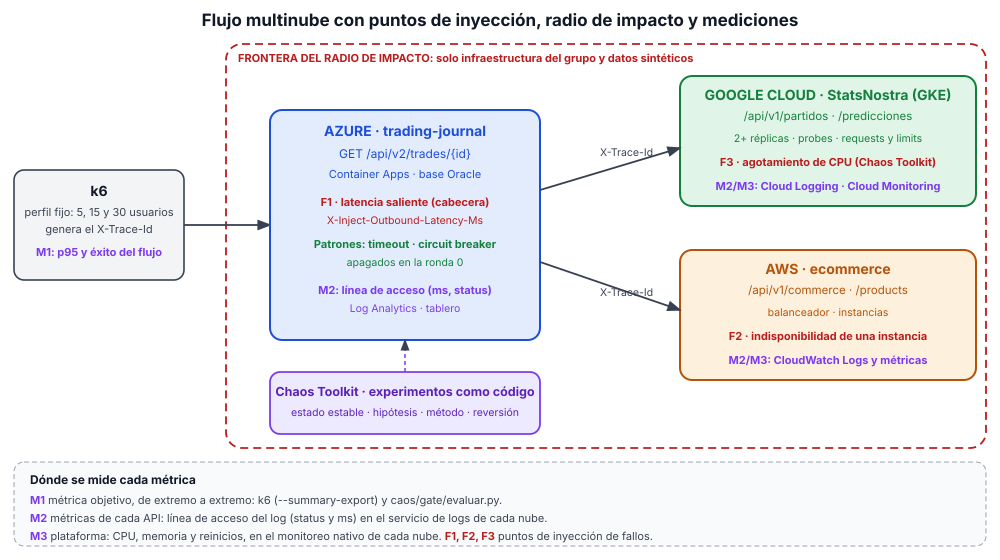

# Informe de ingeniería del caos: flujo multinube de trading-journal

> **Borrador.** Lo marcado como **PENDIENTE** depende de las rondas con k6, que se corren en la ventana anunciada en el chat del equipo. No se escribe ninguna cifra que no salga de la evidencia en `caos/resultados/`. Máximo 6 páginas.

## 1. Resumen y arquitectura

Un cliente consulta `GET /api/v2/trades/{id}` en el **coordinador** (Azure Container Apps, con base Oracle). Por cada consulta, el coordinador llama a **StatsNostra** (Mari, GKE en Google Cloud) y a **ecommerce** (Pipe, AWS), y devuelve el registro unido. El mismo `X-Trace-Id` viaja por las tres nubes y queda en el log de cada una. Pregunta del experimento: **¿se mantiene el flujo rápido y disponible cuando una de las dependencias falla?**

Tres fallos, uno por nube, sobre el mismo flujo y el mismo perfil de carga: **F1** latencia saliente del coordinador hacia Mari (Juan, Azure); **F2** indisponibilidad de tareas de la API de Pipe (AWS); **F3** agotamiento de CPU de un pod de Mari (GKE).

## 2. Estado estable y perfil de carga

Perfil fijo de k6 (`caos/carga/perfil.js`): rampa de 5, 15 y 30 usuarios virtuales, 60 s cada uno, contra el flujo completo. Estado estable medido con todos los interruptores y patrones de resiliencia apagados:

| Corrida | Éxito | p50 | p95 | p99 |
|---|---|---|---|---|
| 1 | 100 % | 428 ms | 1 289 ms | 1 897 ms |
| 2 | 100 % | 417 ms | 1 392 ms | 1 856 ms |
| 3 | **PENDIENTE** (la corrida del 13 de nov. se descartó: coincidió con un reinicio de los pods de Mari) | | | |

Estado estable declarado (provisional hasta repetir la corrida 3): éxito ≥ 99 % y p95 extremo a extremo ≤ 1 600 ms (mediana medida de 1 289 ms más un margen del 25 %).

## 3. Hipótesis, métrica, instrumento y ventana (una por integrante)

| | Fallo | Hipótesis | Métrica objetivo | Instrumento y ventana |
|---|---|---|---|---|
| Juan | F1: 3 000 ms de latencia hacia Mari | Con la latencia inyectada, el flujo mantiene éxito ≥ 99 % y p95 ≤ 1 600 ms | p95 de extremo a extremo | k6 (`--summary-export`) y línea de acceso del coordinador en Log Analytics; 3 min de carga con la falla activa |
| Pipe | F2: se detiene el 50 % de las tareas ECS | El flujo sigue respondiendo y el servicio se recupera sin disparar la alarma de aborto | éxito del flujo | k6 y CloudWatch; **PENDIENTE: sus cifras** |
| Mari | F3: CPU de un pod al 100 % durante 3 min | El p95 del flujo se mantiene dentro del umbral | p95 de extremo a extremo | k6 y Cloud Monitoring; ronda 0 con p95 de 3 425 ms (hipótesis refutada), ronda 1 con 774 ms (se cumple) (datos de su repositorio) |

## 4. Método y radio de impacto

Cada experimento es un archivo de Chaos Toolkit con estado estable, hipótesis, método y reversión (`caos/experimentos/`). La falla de Juan se activa con la cabecera `X-Inject-Outbound-Latency-Ms` (apagada por defecto, solo con `FAULT_HEADER_ENABLED=true`), con un tope de 10 s. **Radio de impacto:** solo la infraestructura del grupo, datos sintéticos y el trade 5540; perfil máximo de 30 usuarios virtuales. **Condiciones de aborto:** éxito del flujo por debajo del 50 % o p95 por encima de 15 000 ms (k6 detiene la prueba a los 20 s). **Interruptor de parada:** quitar la cabecera o `FAULT_HEADER_ENABLED=false`. **Reversión probada:** latencia 662 ms sin falla, 6 709 ms con la falla de 3 000 ms (se aplica en dos llamadas seguidas a Mari) y 659 ms al apagarla (`caos/resultados/02-prueba-de-inyeccion-y-reversion.md`).

## 5. Ronda 0: resultados y modo de fallo

**PENDIENTE** (ronda 0 con k6). Lo esperado, por la prueba de reversión: el p95 sube a unos 6 700 ms porque cada llamada a Mari espera los 3 000 ms completos, sin timeout ni circuit breaker: **fallo en cascada** de una dependencia lenta hacia el tiempo de respuesta total. Diagnóstico con el trace id: la línea de acceso del coordinador (`ms`) frente a la de Mari (`ms`) para el mismo `traceId`.

## 6. Mejoras aplicadas y justificación

1. **Timeout por llamada a cada dependencia** (`COMPANIONS_CALL_TIMEOUT_MS=1000`): una dependencia lenta no debe consumir todo el tiempo de la petición.
2. **Circuit breaker de Resilience4j** (`RESILIENCE_CB_ENABLED=true`): tras varias llamadas lentas o fallidas, deja de llamar a la dependencia y responde de inmediato con la entidad en `null`, que el flujo ya sabía absorber.

Ambos están apagados por defecto, de modo que la ronda 0 mide el sistema sin protección y la ronda 1 se activa con una sola variable.

## 7. Ronda 1 y comparación

**PENDIENTE.** Tabla con p95, éxito y variación porcentual entre ronda 0 y ronda 1, con el mismo perfil de carga, y la conclusión sobre la hipótesis.

## 8. Hallazgos inesperados y backlog de resiliencia

- El tiempo total de una petición es la **suma** de las llamadas seguidas a Mari: una latencia de 3 000 ms se paga dos veces. Backlog: hacer las llamadas a las dependencias en paralelo.
- El estado estable de una corrida se puede arruinar por un cambio ajeno (reinicio de pods de Mari): la regla de avisar la ventana en el chat nació de ahí.
- El instrumento de medición de las tres nubes debía imprimir `traceId`, `status` y `ms` en cada línea; el formato del log se acordó antes de medir.

## 9. Uso de IA

**PENDIENTE: a completar por Juan antes de entregar** (herramienta, qué propuso y qué se descartó).
