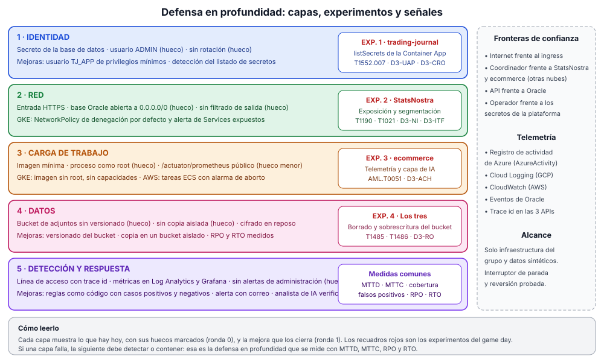

# Caos de seguridad: game day sobre la arquitectura multinube

Evaluación final de Defensa en Profundidad. Verifica experimentalmente si los controles de las capas de identidad, red, carga de trabajo, datos y detección y respuesta **detectan, contienen y resisten** condiciones adversas, sobre la arquitectura multinube construida en el énfasis de DevOps (Azure, Google Cloud, AWS y Oracle). Esta carpeta es la parte de trading-journal (coordinador en Azure y datos en Oracle); StatsNostra (GKE) y ecommerce (AWS) documentan la suya en sus repositorios con el mismo formato.

> Estado: experimentos 1 y 4 ejecutados el 16 de noviembre de 2026 (rondas 0 y 1); informe en [`informe/informe-seguridad-final.pdf`](informe/informe-seguridad-final.pdf). Entrega el 18 de noviembre (release v5.1.0). Pendiente: la evidencia de Pipe y el contraste con un segundo asistente de IA.



| Documento | Contenido |
|---|---|
| [`reglas-de-compromiso.md`](reglas-de-compromiso.md) | Ventana, alcance, datos, radio de impacto, interruptor de parada, reversión, bitácora y condiciones de aborto |
| [`inventario-controles.md`](inventario-controles.md) | Controles por capa con su estado de hoy, sus huecos y su mapeo con D3FEND, ISO 27001 y NIST |
| [`identidad/`](identidad/) | Experimento 1: regla de detección, script del experimento y mejoras |
| [`datos/`](datos/) | Experimento 4 (grupal): resiliencia de los datos en Oracle Object Storage |
| [`ia/`](ia/) | Analista de IA con sanitización de la entrada y verificación de la respuesta |
| [`bitacora.md`](bitacora.md) y [`resultados/`](resultados/) | Bitácora de cada acción y resultados de cada ronda: [`01-identidad.md`](resultados/01-identidad.md) y [`04-resiliencia-de-datos.md`](resultados/04-resiliencia-de-datos.md) |
| [`tendencias.md`](tendencias.md) | Tendencias verificables con fuente y fecha de consulta |
| [`informe/`](informe/informe-seguridad-final.pdf) | Informe final del game day (9 páginas: el de Juan y Pipe más la sección de Mari), generado con `python seguridad/informe/generar_informe.py` y ensamblado con `python caos/informe/ensamblar.py seguridad` |

## Experimentos

| # | Capa | Responsable | Condición adversa | Mapeo |
|---|---|---|---|---|
| 1 | Identidad de máquina | Juan | Alguien con acceso de administración lista los secretos de la Container App | ATT&CK T1552.007 · D3FEND D3-UAP, D3-CRO |
| 2 | Exposición y segmentación | Mari | Aparece una ruta no declarada (Service expuesto, salto entre namespaces, salida a Internet) | ATT&CK T1190, T1021 · D3FEND D3-NI, D3-ITF |
| 3 | Telemetría y capa de IA | Pipe | Telemetría con instrucciones plantadas y analista de IA | ATLAS AML.T0051 · D3FEND D3-ACH |
| 4 | Resiliencia de los datos | Los tres | Borrado y sobrescritura masiva del bucket de objetos | ATT&CK T1485, T1486 · D3FEND D3-RO |

Los identificadores de ATT&CK, D3FEND y ATLAS se comprobaron en los sitios oficiales de MITRE (attack.mitre.org, d3fend.mitre.org y el repositorio `atlas-data` de ATLAS) el 16 de noviembre de 2026.

## Experimento 1: identidad de máquina del coordinador

**Hipótesis de control.** Con la configuración de hoy, cuando alguien liste los secretos de la Container App esperamos una alerta en 15 minutos o menos (T1) y que la credencial expuesta no sea la de la cuenta con privilegio máximo (T2).

**Señal.** El registro de actividad de Azure (`AzureActivity`, operación `MICROSOFT.APP/CONTAINERAPPS/LISTSECRETS/ACTION`) en el espacio de trabajo `log-caos`, y una regla de alerta programada.

**Ronda 0 (sin mejoras).** El registro de actividad no se recoge en `log-caos` y no hay regla: se espera que la hipótesis se refute, porque la acción pasa sin que nadie se entere. Además, la credencial listada es la de `ADMIN`.

**Mejoras de la ronda 1.**
1. Configuración de diagnóstico del registro de actividad hacia `log-caos`, grupo de acciones con correo y regla de alerta ([`identidad/deteccion.kql`](identidad/deteccion.kql), con casos positivos y negativos en [`probar_deteccion.py`](identidad/probar_deteccion.py)).
2. Usuario `TJ_APP` con solo lectura y escritura sobre las tablas del esquema, que sustituye a `ADMIN` en el secreto ([`identidad/usuario_minimo.py`](identidad/usuario_minimo.py)).

```bash
python seguridad/identidad/experimento.py atacar --ronda 0   # ronda 0
python seguridad/identidad/experimento.py medir --ronda 0
python seguridad/identidad/experimento.py mejorar            # ronda 1: diagnóstico, grupo de acciones y regla
python seguridad/identidad/usuario_minimo.py aplicar         # ronda 1: usuario de privilegios mínimos
python seguridad/identidad/experimento.py atacar --ronda 1
python seguridad/identidad/experimento.py medir --ronda 1
python seguridad/identidad/experimento.py revertir           # deja el estado de la ronda 0
```

## Experimento 4: resiliencia de los datos (grupal)

**Hipótesis de control.** Con un borrado y una sobrescritura masiva del bucket, se recupera el 100 % de los objetos íntegros (comprobados por suma de verificación) con un RTO de 10 minutos o menos y sin pérdida de datos.

**Ronda 0.** Bucket sin versionado y sin copia: lo esperado es que no se recupere nada. **Ronda 1.** Versionado del bucket y copia en un bucket aislado: se recuperan los objetos de la versión anterior o de la copia. El bucket guarda un objeto sintético por cada API del grupo, que representa lo que cada una guarda del flujo.

```bash
python seguridad/datos/experimento.py preparar && python seguridad/datos/experimento.py poblar
python seguridad/datos/experimento.py atacar --ronda 0 && python seguridad/datos/experimento.py restaurar --ronda 0 && python seguridad/datos/experimento.py medir --ronda 0
python seguridad/datos/experimento.py mejorar
python seguridad/datos/experimento.py atacar --ronda 1 && python seguridad/datos/experimento.py restaurar --ronda 1 && python seguridad/datos/experimento.py medir --ronda 1
python seguridad/datos/experimento.py destruir               # limpieza final
```

La lógica de restauración se prueba con un almacén de objetos simulado (`python -m pytest seguridad/datos/test_experimento.py`).

## Trazabilidad: control, riesgo, norma y evidencia

| Control o mejora | Riesgo que mitiga | ATT&CK | D3FEND | ISO/IEC 27001:2022 | NIST SP 800-53 | Evidencia |
|---|---|---|---|---|---|---|
| Alerta sobre `listSecrets` en el registro de actividad | Robo de credenciales sin que nadie lo vea | T1552.007 | | 8.15, 8.16 | AU-6, SI-4 | `resultados/01-ronda-*.json` |
| Usuario `TJ_APP` de privilegios mínimos en lugar de `ADMIN` | Una credencial robada da control total de la base | T1552.007, T1078.004 | D3-UAP | 8.2, 5.15 | AC-6 | `bitacora.md` |
| Contraseña nueva y aleatoria en el secreto (la de `ADMIN` sale de la Container App) | Credencial vieja y expuesta que sigue válida en la plataforma | T1552.007 | D3-CRO | 5.17 | IA-5 | `usuario_minimo.py` y la bitácora |
| Versionado del bucket de objetos | Borrado o sobrescritura irreversible | T1485, T1486 | D3-RO | 8.13 | CP-9 | `resultados/04-ronda-*.json` |
| Copia aislada de los objetos | Un actor con acceso al bucket destruye también las copias | T1485 | D3-RO | 8.13 | CP-6, CP-9 | `resultados/04-ronda-*.json` |
| NetworkPolicy de denegación por defecto (Mari) | Movimiento lateral y salida sin filtrar | T1021, T1190 | D3-NI, D3-ITF | 8.20, 8.22 | SC-7 | Repositorio de StatsNostra |
| Sanitización de la telemetría y verificación de la IA | Instrucciones plantadas en logs; cifras inventadas | | D3-ACH | 8.28 | SI-10 | `ia/test_analista.py` |

**Arquitectura de confianza cero (NIST SP 800-207).** Los controles de identidad de este game day aplican el principio de acceso con el menor privilegio y la verificación continua (la credencial de la API ya no es la del administrador y su uso queda registrado y alertado), y la segmentación de Mari aplica la microsegmentación entre cargas de trabajo.

> Verificación (16 de noviembre de 2026): los identificadores de MITRE se comprobaron en sus sitios oficiales; los 16 controles de ISO/IEC 27001:2022 Anexo A citados (5.15, 5.17, 5.24, 8.2, 8.3, 8.4, 8.9, 8.11, 8.13, 8.15, 8.16, 8.20, 8.22, 8.23, 8.24 y 8.28) coinciden en número y título con el catálogo público de isms.online; y los 15 controles de NIST SP 800-53 citados (AC-6, IA-5, AU-3, AU-6, SI-4, CP-9, CP-6, SC-7, SC-28, CM-5, CM-6, CM-7, IR-4, SA-11 y SI-10) coinciden con el catálogo oficial OSCAL de NIST (Rev. 5, versión 5.2.0).
