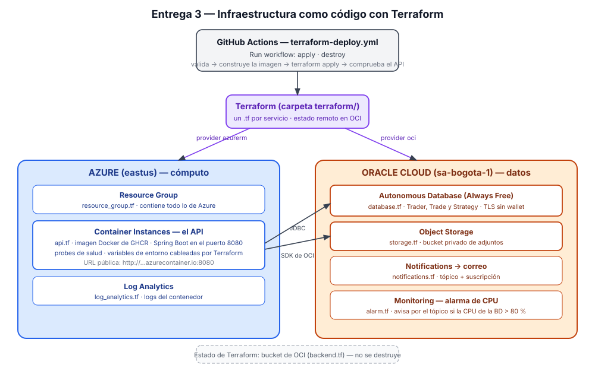

# Infraestructura como código — Trading Journal API (Entrega 3)

Terraform crea y destruye, con un solo comando o con un pipeline, toda la infraestructura que el API necesita. Reproduce la arquitectura de la Entrega 2 (cómputo en Azure, datos en Oracle Cloud) como código.

## Arquitectura



En texto:

```text
                         GitHub Actions (terraform-deploy.yml)
                                      │  terraform apply
              ┌───────────────────────┴───────────────────────┐
              ▼                                               ▼
   Azure (eastus)                                  Oracle Cloud (sa-bogota-1)
   ┌─────────────────────────────┐                 ┌──────────────────────────────┐
   │ Resource Group              │                 │ Autonomous Database (Free)   │
   │  ├ Container Instances ─────┼── JDBC (TLS) ──►│ Object Storage (adjuntos)    │
   │  │   (el API, imagen GHCR)  ├── SDK de OCI ──►│ Notifications (correo)       │
   │  └ Log Analytics (logs)     │                 │ Monitoring (alarma de CPU)   │
   └─────────────────────────────┘                 └──────────────────────────────┘
```

### Servicios en la nube (7, con base de datos)

| # | Servicio | Nube | Archivo | Para qué sirve |
|---|---|---|---|---|
| 1 | Autonomous Database (Always Free) | OCI | `database.tf` | Base de datos del API (Trader, Trade, Strategy) |
| 2 | Object Storage | OCI | `storage.tf` | Bucket privado de adjuntos (`/api/v2/attachments`) |
| 3 | Notifications | OCI | `notifications.tf` | Tópico y suscripción por correo para las alertas |
| 4 | Monitoring | OCI | `alarm.tf` | Alarma si la CPU de la base de datos supera el 80 % |
| 5 | Resource Group | Azure | `resource_group.tf` | Contenedor lógico de todo lo de Azure |
| 6 | Log Analytics | Azure | `log_analytics.tf` | Guarda los logs del contenedor del API |
| 7 | Container Instances | Azure | `api.tf` | Ejecuta el API: aquí se **instala** la aplicación |

**Por qué dos nubes:** el plan original era solo OCI, pero la máquina virtual gratuita de Bogotá (ARM) no tiene capacidad — `Out of host capacity` en cada intento, el mismo problema que ya hubo con OKE en la Entrega 2 — y la prueba gratuita de OCI vence a los 30 días. Se conservó la división de la Entrega 2: **OCI para los datos** (gratis) y **Azure para el cómputo**.

## Estructura

```text
terraform/
├── environments/
│   └── dev.example.tfvars   # plantilla de variables (la real, dev.auto.tfvars, no se sube a Git)
├── scripts/
│   ├── bootstrap-state.sh   # crea una vez el bucket del estado remoto
│   ├── destroy.sh           # elimina toda la infraestructura (no necesita make)
│   └── empty-bucket.sh      # vacía el bucket de adjuntos antes de destruir
├── evidencias/              # logs y pruebas de la ejecución real (ver su README)
├── alarm.tf                 # OCI Monitoring
├── api.tf                   # Azure Container Instances
├── backend.tf               # estado remoto en OCI Object Storage
├── database.tf              # OCI Autonomous Database
├── locals.tf
├── log_analytics.tf         # Azure Log Analytics
├── notifications.tf         # OCI Notifications
├── outputs.tf
├── providers.tf
├── resource_group.tf        # Azure Resource Group
├── storage.tf               # OCI Object Storage
├── variables.tf
├── versions.tf
└── Makefile
```

Un archivo por servicio, más los archivos de configuración compartida. El estado vive en un bucket de OCI (`backend.tf`) para que tu máquina y el pipeline vean siempre la misma infraestructura.

## Requisitos

- Terraform **1.12 o superior** (el backend `oci` no existe antes).
- CLI de OCI configurado (`~/.oci/config`) y una llave API; CLI de Azure (`az login`).
- Una vez por suscripción de Azure, registrar los proveedores que usa el despliegue:

  ```bash
  az provider register --namespace Microsoft.ContainerInstance
  az provider register --namespace Microsoft.OperationalInsights
  ```

## Despliegue desde tu máquina

```bash
cd terraform

# 1. Bucket de estado (una sola vez; es idempotente)
make bootstrap

# 2. Variables locales
cp environments/dev.example.tfvars environments/dev.auto.tfvars
#    Reemplace todos los valores REEMPLAZAR. Ese archivo no se confirma en Git.

# 3. Inicializar, revisar y aplicar
terraform init
terraform fmt -check -recursive && terraform validate
terraform plan  -var-file=environments/dev.auto.tfvars
terraform apply -var-file=environments/dev.auto.tfvars
```

Al terminar, `terraform output api_url` muestra la dirección pública del API. La base de datos tarda ~1 minuto y el contenedor ~1 minuto más en estar listo.

## Despliegue con el pipeline

El workflow [`terraform-deploy.yml`](../.github/workflows/terraform-deploy.yml) se ejecuta a mano: **Actions → Terraform - Desplegar o destruir → Run workflow** y se elige `apply` o `destroy`.

Con `apply` hace, en orden:

1. **Validar** — `terraform fmt -check` y `terraform validate`.
2. **Construir la imagen del API** — compila, corre las 68 pruebas y publica `ghcr.io/juanpa28/trading-journal-api:tf-<sha>`.
3. **Crear la infraestructura** — `terraform apply` en OCI y Azure, pasando esa imagen como `api_image_tag`. **Esto instala el API.**
4. **Comprobar** — consulta `/actuator/health` hasta recibir `200`.

### Secrets de GitHub requeridos

| Secret | Contenido |
|---|---|
| `OCI_CLI_TENANCY`, `OCI_CLI_USER`, `OCI_CLI_FINGERPRINT`, `OCI_CLI_KEY_CONTENT` | Credenciales de la llave API de OCI |
| `AZURE_CLIENT_ID`, `AZURE_CLIENT_SECRET`, `AZURE_TENANT_ID`, `AZURE_SUBSCRIPTION_ID` | Service principal de Azure con rol Contributor sobre la suscripción |
| `DB_ADMIN_PASSWORD` | Contraseña de ADMIN de la Autonomous Database |
| `ALERT_EMAIL` | Correo que recibe las alertas de OCI |

## Eliminar la infraestructura

Al terminar la sustentación hay cuatro formas, todas equivalentes:

```bash
# Desde tu máquina (vacía el bucket de adjuntos y destruye todo)
make destroy

# Lo mismo, sin make (por ejemplo en Windows con Git Bash)
bash scripts/destroy.sh
```

```bash
# O directamente
bash scripts/empty-bucket.sh "$(terraform output -raw bucket_name)"
terraform destroy -var-file=environments/dev.auto.tfvars
```

O desde GitHub: **Run workflow → `destroy`**.

El bucket del estado (`trading-journal-tfstate`) **no** se elimina: Terraform lo necesita para saber qué destruir y no forma parte de la infraestructura del API. Se borra a mano al final del curso si se desea:
`oci os bucket delete --namespace-name <namespace> --bucket-name trading-journal-tfstate --force`.

> El bucket de adjuntos se vacía antes del `destroy` porque OCI no permite borrar un bucket con objetos.

## Evidencias de ejecución

En [`evidencias/`](evidencias/) están los logs del pipeline (crear todo desde cero y destruirlo), las salidas de Terraform, las pruebas contra el API desplegado y el inventario de recursos consultado a OCI y Azure.

## Seguridad y costos

- **Costos:** todo lo de OCI es *Always Free*. En Azure, Container Instances (1 vCPU, 2 GB) cuesta unos 1,5 USD por día encendido, por eso se destruye al terminar de usarlo; la suscripción de prueba tiene límite de gasto, así que no puede generar cargos a una tarjeta.
- **Secretos:** `dev.auto.tfvars`, los archivos `*.tfstate`, los planes (`tfplan`) y las llaves `*.pem` están en `.gitignore`. Las contraseñas y la llave de OCI se declaran `sensitive`.
- **Estado:** Terraform conserva en el estado los valores sensibles (contraseña de la base de datos, llave de OCI). El bucket de estado es privado (`NoPublicAccess`); restrinja quién puede leerlo.
- **Red:** la base de datos acepta conexiones desde cualquier IP (`0.0.0.0/0`) con TLS, porque Container Instances no tiene una IP de salida fija. Es una simplificación de laboratorio; en producción se usaría un endpoint privado.
- **Base de datos:** `terraform destroy` elimina la Autonomous Database y todos sus datos.
